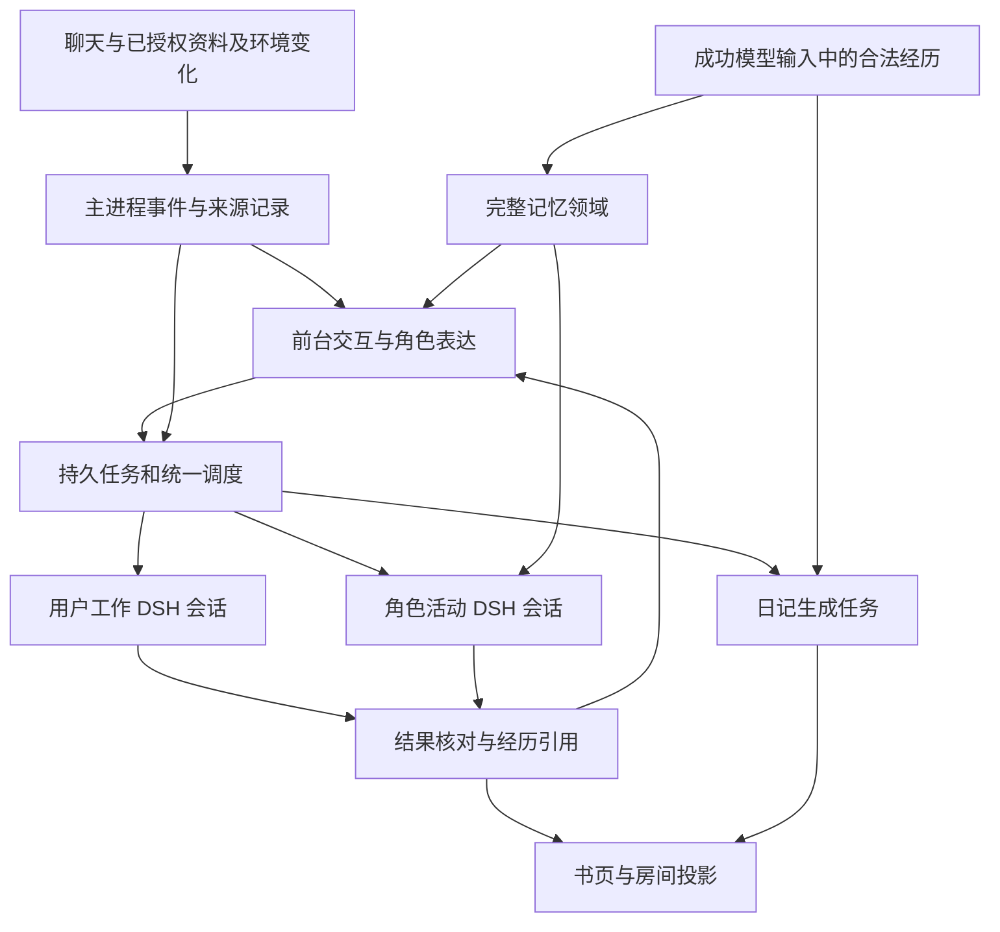

# LCA 记忆与角色生活的综合改造探索

日期：2026-10-31。分支：`codex/continuous-work-p0`。研究基线：`aa54d060cd2439a273e65a7871df1ae7bea2cd85`。

**2026-11-01 方向更新：** 用户将当前重点收敛到记忆，并要求优先直接复用 AIRI mods 分支，接受向量模型与镜像的复杂度。后续以 [直接复用评估](airi-memory-direct-reuse-20261101.md) 为实施依据：完整保留已有记忆机制，适配宿主；不再默认重写 SQLite 简化仓储。生活、日记暂作为后续消费者，本文其余探索保留，不全部并行推进。

用户将持续工作探索扩展到黑客松时期遗留的不可用能力，并明确要求：记忆参考自己的 AIRI 改造版本，放弃 LCA 的轻量实现；世界泡和日记的直接体验问题是“从来没感觉这两个效果触发过”。因此，支线的目标扩展为工作、记忆与角色生活的连续性。第一条体验闭环是：**她做过一件事，能与你谈起，写进当日回顾，隔天仍能正确记得；过程中你可以继续交流。**

本轮完成源码审计与纯函数反例实验，未更换生产记忆、修改生活策略、调用真实模型或读取私人存档。原有 [持续工作计划](lca-continuous-work-plan-20261031.md) 和 [P0 实验](lca-continuous-work-p0-20261031.md) 是共同底座，下面的路线扩展其范围，不改写历史验收结果。

## 1. 本轮已确定的方向

| 性质 | 决定 |
| --- | --- |
| 用户明确要求 | 在当前独立实验分支综合探索；记忆采用 AIRI 改造体系作为参照，退役现有轻量主路线；让世界泡与日记在普通使用中实际发生并被感知 |
| 本轮设计建议 | 统一事件、持久任务、上下文引用与交付；在这一底座上分别建立记忆领域、生活活动与日记任务 |
| 尚需实验判断 | 记忆审核的交互成本、语义检索策略与模型、生活主动频率、日记形成与解锁时机、情绪重排的实际收益 |
| 保持原状 | main 的其他工程、已接入的 DSH 执行与 Team、原始历史、现有素材；不扩大到云端常驻、远程接管或关系阶段 / 好感度规则 |

“放弃轻量实现”指替换记忆的表达、召回、修改与生命周期，而不是删除旧经历，也不意味着必须移植 AIRI 的 Vue / Pinia / DuckDB 宿主。完整的领域能力应运行在 LCA 主进程，由现有受限接口供界面和 DSH 使用。

## 2. 为什么用户可能完全感受不到它们

下表是当前源码中的可达性和生命周期问题。它们可以解释用户报告，但未检查用户日用 profile，不能将每一项都断言为其机器上的已复现根因。

| 模块 | 已核实实现 | 对正常体验的影响 | 建议处理 |
| --- | --- | --- | --- |
| 生活阅读 / 写作入口 | 当前应用代码中 `life/material` 唯一写入点是开发命令 `developer.life.seed`；材料 schema 只接受 `source: fake`；没有普通资料登记入口 | 即使接上真实后台模型，正常用户也缺少开始阅读 / 写作所需的材料；按钮因材料为空而不可用 | 退役合成专用生产路线，增加正式的授权书架 / 选材入口，合成材料只留在测试 |
| 生活工作形态 | 强制 read / write、固定三步、只选第一份材料；提示词明确只处理 synthetic desk material，不传角色卡 | 有模型和文件写入并不形成她自己的持续活动；难以有选择、发展与成果回流 | 用持续任务表示活动目标和阶段，DSH 执行，产物和体验分开留记录 |
| 自动散步 | 每日固定 15:00，默认周末 / 休息；创建提议时才检查空闲 15 分钟。若此时不满足，agenda 已置为 settled，后续 tick 不再尝试该 proposed 外出 | 刚说过话便可能错过唯一自动出发窗口；后面空闲也不会自然发生 | 将提议与实际出发分开；只要仍有意义，等待下一次合适机会，而非把短暂忙碌结算成结束 |
| 日记触发 | 仅选择已结束日页、最近三天中有 `model/seen` 片段的一天，最多取末尾 12 片段；依赖日页真正轮转 | 当天没有日记；少量或不连续使用、日切延迟都可能使入口长期没有内容 | 为“结束一天”建立持久任务；先判断当天是否有值得留下的经历，再维护可恢复的待写状态 |
| 日记被打断 | 写入前就记录 `diary/attempt`；自动路径见到该天已有 attempt 就跳过；前台交互会 abort。既有单测也要求这种情况下自动调用为 0、手动重试才能继续 | 一次普通聊天打断即可把自动日记变成需要用户发现并点击的失败项 | 区分排队、被前台抢占、失败、完成；普通抢占后恢复，不按已尝试等同已处理 |
| 日记可见性 | `unlockAtMs` 取“写入时所属日页的次日 04:00”，而内容本来已来自过去日页 | 昨天的日记今天生成，通常还需再等至下一日界才看见 | 将源日、生成时刻和展示时刻分离；保留书签仪式，但实验取消额外等待一天 |
| 记忆抽取 | 空闲至少 120 秒后，每轮最多 5 个片段；前台会中断；日切又由记忆 maintenance 协调 | 持续交流可能使整理长期后移，日页、记忆和日记互相等待 | 日切独立于抽取是否成功；抽取有持久游标、积压和可恢复调度 |
| 记忆内容与召回 | 只允许连续原句，topic 必须是原句子串；更正依赖同 topic 和少数中文词；单项验证失败使整批失败。检索使用汉字二元组 / 英文 token 重合，必须有字面交集 | 同义表达可能漏召回，语义整理受到限制；真实对话中的更正不应依赖固定措辞 | 以 AIRI 的事实正文、来源、版本、更正和多路召回替换主路线；精确摘录检查只服务于确需引用的证据 |
| 记忆“使用”计数 | 候选被搜索返回即记 access；当前引用统一标作 unreviewed；模型工具只有 `search_memory` | 找到条目不能证明回答用到了它；缺少自然的读正文、记住、更正、忘记闭环 | 分开检索、注入、读取和行为采用；加入可核对的操作回执 |
| 全局忙碌与前台优先 | `herBusy()` 及多个服务互斥检查；前台同时 abort memory、diary、lifeWork；生活作品只供用户查阅，世界上下文只带作品元数据 | 用户一说话，各后台活动便可能丢掉本次进展；作品做出来也缺少内容进入自然交流的路径 | 复用持续工作调度，优先响应用户但保留后台身份和检查点；用简短、有效的成果引用回到前台 |

主要依据：[生活服务](../../src/main/life/service.ts)、[生活工作](../../src/main/life/work/service.ts)、[材料与步骤契约](../../src/main/life/work/schema.ts)、[生活提示](../../src/main/life/work/protocol.json)、[日记服务](../../src/main/diary/service.ts)、[日记测试](../../tests/unit/diary.test.ts)、[记忆服务](../../src/main/memory/service.ts)、[抽取校验](../../src/main/memory/model.ts)、[检索](../../src/main/memory/retrieval.ts)、[主进程接线](../../src/main/index.ts)。

这些模块存在定时器、持久状态和测试，不宜概括成“完全没有实现”。问题在于正常入口、恢复与交付之间缺少完整路径。下一轮测试必须从普通入口走通，不能靠开发 seed 或直接调用内部方法证明“用户会感受到”。

## 3. AIRI 中值得移植的部分

参照的是本机 `D:/airi` 的实际工作区：HEAD `229ac0de5ef03035d596387ba0a150c875344353`，其中记忆相关文件有已修改和未跟踪内容。本次只读，未安装依赖、启动 AIRI / Docker 或接管其服务；引用按文件 SHA-256 固定，不能只用 HEAD 代表这些改造。

| AIRI 机制与实现位置 | LCA 应获得的能力 | 适配判断 |
| --- | --- | --- |
| `packages/memory-core`：事实、来源、生命周期、展示与操作契约 | 事实正文与标题 / 摘要分离；短期 / 长期；active / superseded / disputed；ID、版本、用户与角色作用域 | 优先提取或移植纯领域部分，保留来源许可；时间与宿主操作改走 LCA 的 Clock / 主进程 |
| `stores/modules/memory.ts` + `local-memory.ts`：向量检索、原问题与归一化问题合并、重排 | 通过语义找到相关记忆，保留来源邻近上下文；记录实际命中与遗漏 | 11 月 1 日修正：保留 AIRI 的 DuckDB 仓储和检索主体，优先适配主进程宿主；不另写 SQLite 简化版，驱动兼容性通过隔离探针确定 |
| `memory-core/interaction.ts`：稳定置顶目录、简介、正文 | 常用已生效事实可直接进入有界目录，详细内容按 ID 读取 | 直接对应 Super-agent 的 Inline & Spill；目录可用不依赖 embedding 可用 |
| `tools/memory.ts` + `services/memory/interactions.ts` | 对话中的 read / remember / correct / forget；来源、目标版本与持久回执 | 接 DSH 窄工具，复用 LCA 问题 / 操作卡；不另建一个会话循环 |
| `memory-core/source-context.ts` 与冻结轮次身份 | 知道记忆来自哪一次经历，跨角色 / 项目不会读错 | 使用 LCA 成功模型输入的合法来源；不给 Worker 整份私人对话和关系记忆 |
| 事实库就绪与向量就绪分开 | embedding 下载、配置或迁移故障不应使全部记忆消失 | 一般阅读、已批准事实、目录与更正仍可用；语义召回故障有明确状态 |
| 更正、删除 tombstone、镜像 outbox | 纠正后旧事实不再影响新回答；恢复与重试不制造重复事实 | 本地权威存储先完成。pgvector 镜像不是本地记忆可用的前置条件 |
| decay / score / promotion / dream | 有限遗忘、跨经历巩固、相关情绪重排、从记忆形成兴趣候选 | 保留可比较能力，不把默认权重当作已证实的心理模型；dream idea 仍与事实分开 |

完整记忆不等于默认开启每种算法。先确保“记得对、能找到、能纠正、持续保存”，再比较情绪重排、突发回想和后台整理是否增加实际价值。候选进入上下文不等于模型采用；同一上下文能答对不等于跨会话记忆成功。

AIRI 的审核和恢复语义也需要审视。它当前的交互操作先进入 `pending_review`；这避免模型自行批准，却会增加使用步骤。LCA 不应照抄一套处处弹卡的体验。建议区分用户对已展示内容的直接操作、模型归纳候选和高影响更正，复用同一操作 ID，已授权的相同内容不重复询问。最终默认策略通过体验实验确定，不在这次审计中静默改变。

AIRI 也不是已经完美验收的成品：`memory-v3-retest-20261029.md` 保留恢复开关、跨窗口健康和 Flow 会话选择失败；`memory-v3-state-repair-20261029.md` 记录后续 91 项离线检查通过，正式复验仍待安排。本轮据此借鉴所有权、就绪状态和正反例设计，不把它的旧结果记到 LCA 名下。

AIRI 根许可及 `memory-core` 为 MIT。正式复用代码时固定来源、保留版权与许可，更新 LCA 第三方声明。此次只增加研究装置与计划，未将 AIRI 源码复制进产品。

## 4. 共同架构如何服务工作、记忆和生活

与文章 / 官方原型的对应关系如下；完整记忆与角色生活本身属于 LCA 的扩展设计，不能说成上游已提供这些模块。

| 上游思路 | 此次扩展中的用途 |
| --- | --- |
| Router / Worker 与异步执行 | 桃子的前台保持交流；阅读、写作、日记等有独立执行身份，结果回到前台 |
| Ticket / Assignment 与持久状态 | 一次阅读、某一天的日记不因回合结束而消失；每次尝试挂在同一活动下 |
| Trigger / Thread 与订阅直通 | 新材料、活动进展、日界和更正事件进入相应任务；已有任务不被重复创建 |
| Inline & Spill、按需对象图 | 前台先看活动摘要、成果引用和记忆目录，需要时按 ID 展开正文及合法来源 |
| 先持久化、投递与消费分开 | 区分活动完成、消息交付和实际进入模型上下文；避免“已生成”却永远没有被桃子谈起 |

这里共享任务调度和事件基础设施，但保留内容的含义：

- **工作事实**记录真实执行、产物和未知结果，由工具与产物证明。
- **角色生活事件**记录虚构世界中已提交的地点、活动、物品与时间；模型可以提出选择和描述，代码确认状态转移。
- **记忆事实与经历**保存允许进入记忆的来源、归纳与修订；工作原文、自动事件复述和日记不能绕一圈就变成新事实。
- **日记与想法**保留主观性，允许角色的感受和联想，引用经历但不反向充当证据。

不在底层为三类活动各造一套重试、计时、busy、队列与恢复系统。Scheduler 继续掌管时钟；持久 WorkItem / Run 处理执行身份；记忆领域负责事实及索引；DSH 掌管需要工具的模型执行。纯抽取 / 总结可以是类型明确的任务处理器，不必把每个整理动作扩展成新的 Agent。

## 5. 可探索的六条路线

### A. 完整记忆替换

将当前 `memory/{model,retrieval,projection,service}` 的轻量逻辑拆出并逐步退役，移植 AIRI 领域语义；旧轻量检索只留作迁移期间可重复的比较基线。

第一阶段提供来源可追溯的事实、目录、按 ID 阅读、更正与遗忘；随后接语义召回、来源邻近上下文与可观测的巩固。每个阶段都是完整可用路径，不能把所有功能锁在“向量尚未初始化”后面。旧历史和记忆原件保留，不能直接把旧 unreviewed 条目批量升级为已批准事实，也不能把全量工具输出补灌为新记忆。

### B. 能够持续发展的角色生活

使用已有房间、海岸、秋千和书桌完成第一批场景，不先增加地图与美术资产。角色根据当前状态、已有兴趣、未完活动和已授权材料选择一个小目标。例如继续上次阅读、整理一页自己的笔记、回看一件共同完成的事，或在合适时间散步。

活动记录 `提出 → 等待合适时机 → 进行 → 暂停 / 完成`，具有稳定身份和下一步。天气、时间、位置、材料和执行成本是输入，不强制每天同一时刻做同一套三步流程。普通聊天优先响应，但无需将所有独立活动全部取消；熄灯与用户明确停止仍及时生效。

真实阅读通过正式书架 / 材料登记获得输入，每项材料保留来源与用途范围。虚构活动和真实文件工作分别记录，角色能自然谈起当前活动和结果，也能诚实说还没有读到哪一部分。

### C. 从经历自然形成的日记

把写日记作为可恢复任务，以源日与经历集合标识，不以一次 timer callback 代表一天是否处理完。前台抢占留下待续状态；真正失败保留原因与有限重试；旧日积压可以按明确策略合并或跳过，不能悄悄消失。

材料来自合法的当时见闻，内容按有意义的片段选择，不机械截末尾十二条。可在当天形成草稿，在结束一天后定稿；源日、生成时间、解锁时间分别建模。移除强制正文第一行“主观日记”的模板要求，主观属性由书页标识；正文可以短、有具体细节，也可以没有强行升华。现有加密存档与旧日记读取保留。

建议实验让昨日日记生成后及时进入书签，而非额外锁一天。是否保留延迟打开的仪式作为产品选择单独比较，不把等待错当日记生成失败。

### D. 合适时机的主动交流与交付

建立前台可消费的“发生了什么、有什么可交付、是否需要你决定”的有界事件队列。优先级、相关性、冷却与预算在同一处处理；普通成果等休息时表达，急件和需批准事项沿用现有通知入口。

前台看到的是有效成果引用和必要内容，不是全部工具日志。界面可以用很轻的状态变化表示“正在读”“留了一页笔记”“昨天的日记写好了”；需要排查时再展开未触发原因，正常书页不堆技术诊断。

### E. 减少无效限制，同时保持具体边界

将“所有内容必须逐字摘录”“固定三个步骤”“聊天一来全部 abort”“任何 attempt 都阻止自动再试”这类全局约束，分别改成来源核验、任务阶段、可恢复抢占和明确的失败状态。

保留用户 / 角色归属、来源权限、真实产物、预算与停止等有明确对象的检查。所有阻止正常流程的规则都应有一个可通过的正常场景、一个需要拦截的反例，以及用户能理解的后续操作。不能用“什么都没做，因此没有错误”作为成功标准。

恢复不是无限重试。程序能确定没有执行的内部任务可重新调度；已发出的外部动作仍先核对结果。这一差别应由任务状态处理，减少模型提示里的重复告诫。

### F. 内容质量与感知验证

“活过来”至少包括触发、完成、被感知、被接续四件事。比较同一真实经历下的旧提示和新提示：是否具体、是否符合角色、是否重复汇报状态、是否泛泛总结和强行感动；由用户盲看短样例判断，而不拿禁止词数量代替质量。

给真实使用留一条轻量轨迹：为何选择这项活动、实际推进到哪一步、何时送达、下次有没有接着它继续。底层诊断留在展开视图，不给正常对话增加状态口号。

## 6. 实施顺序与改动边界

| 批次 | 主要工作 | 要交付的可感知结果 |
| --- | --- | --- |
| R0 本轮 | 源码审计、AIRI 来源固定、轻量检索反例、综合方案 | 明确哪些是真的断路，哪些只是未验证；不把不触发全归咎于模型 |
| R1 共同底座 | 续完原 P0 的角色工具、投递 / 恢复、取消与资源争用验证；接口单独提交；任务身份、事件回执和可恢复调度 | 一件后台工作被闲聊打断后仍能继续；生活和日记可复用这个能力 |
| R2 记忆最小完整链路 | AIRI 领域契约到主进程适配、目录 / 按 ID 读、更正 / 忘记、正式界面、迁移 | 用户正常表达和修订偏好，下一会话能读取正确版本；不依赖开发 seed |
| R3 第一条生活与日记闭环 | 正式材料入口、一个可持续活动、前台成果引用、日记任务与可见书签 | 普通使用中能看到她开始、推进、谈起并留下回顾；暂停后可续，源事件可查 |
| R4 语义与长期连续性 | 向量召回、邻近上下文、巩固 / 兴趣候选、跨日和存档迁移 | 换一种说法仍能想起；旧错误不再被采用；隔天活动和共同经历能接续 |
| R5 同负载比较 | 冻结记忆样本、生活事件轨迹与中断场景；真实模型小预算和日用另按授权执行 | 同时比较完成率、行为采用、打扰、延迟、成本与角色表达，而非只数通过的守卫测试 |

R2 / R3 共享来源与经历引用设计；实现可以小步交替，不需要先完成所有长期记忆算法才让第一篇日记出现。也不先开发一个新庞大框架再找用户体验：每批都有普通入口可走的完整路径。

接口预计涉及 `src/shared/` 的工作、来源、记忆操作、活动与日记状态；所有共享契约按项目约定单独提交。主进程的 `work/` 承担共用调度，`memory/` 是主要替换区，`life/`、`diary/` 是主要重构区，`index.ts` 收敛服务互斥；`room/` 与 renderer 消费投影。旧备份格式继续可读，新事实和工作状态明确版本化，恢复不启动旧批准。

## 7. 第一轮验收应长什么样

1. **普通新档启动**：完成正常配置，使用正式入口加入一份合成读物；不使用 developer seed。满足活动时机后确实开始，产物可以打开，前台能引用它。
2. **错过时机后重试**：15:00 前刚聊过天，随后进入休息；提议仍可在下一合适时机推进，不被永远卡在 proposed / skipped。
3. **交流不破坏连续性**：读到一半聊天，再回来能接着读；用户停止才真正停止，重启核对后能续，不把旧产物冒充新完成。
4. **跨日写日记**：正常经历、日切、前台插话、再次空闲；该日记会完成一次并在约定时间可见，源日和展示日明确。
5. **语义回忆**：新会话不带原聊天，换一种表达询问偏好；记录检索到什么、模型读了什么、回答是否实际采用。
6. **自然更正**：用户说“现在更喜欢茶”，不要求必须说“更正 / 改为”；新事实按既定操作生效，旧事实不再被召回为当前偏好。
7. **记忆子系统部分故障**：向量不可用时，目录和按 ID 读取仍可用；后台整理中断后能继续；角色切换后旧任务不写错对象。
8. **主观与事实分开**：日记对一次散步的感受可影响表达或兴趣候选，但不能变成用户真实经历、停机期间真实工作或新的批准。
9. **长期感知**：在约定的可运行窗口里，用户能指出她主动推进过什么、说过什么、留下什么，以及下一天接续了什么；单有日志或按钮不算体验通过。

记忆对照保留空记忆、当前轻量实现、AIRI 风格语义路线，以及目录加按需正文路线。使用相同事实、问题、作用域与预算；置顶 / 未置顶、否定 / 更正、无关噪声分开统计。真实效果测试预先固定样本和失败条件，不因某次效果不佳临时放宽阈值。

## 8. 本轮证据与剩余问题

[研究脚本](../../scripts/research-character-continuity.mjs) 直接调用当前 LCA 的纯检索 / grounding 函数与 AIRI 的纯目录 / 抽取函数，不加载应用或数据库。运行证据见 [摘要与来源指纹](evidence/lca-character-continuity-20261031.json)。

- 两个有明确语义关联、没有字面重合的问题未召回；同词正例召回；“咖啡色”也会被“咖啡”命中。这些是手选反例，说明机制局限，不是通用准确率评测。
- 合理同义归纳被精确摘录校验拒绝；去掉否定的危险截取也被拒绝。后者是需要保留的正确边界，前者说明不能把同一校验器当作完整语义记忆模型。
- AIRI 已批准置顶事实在没有向量的情况下仍可形成目录；pending 和 superseded 不进入目录；访问次数变化不改变目录字符串。抽取 parser 接受归纳正文只证明契约支持，不证明该归纳正确或实际落库。
- 29 个相关源码 / 文档文件保存 SHA-256。本轮没有复制 AIRI 私人数据库、测试 profile、连接配置或历史聊天。

日用实例的实际触发轨迹、当前模型输出质量，以及完整语义检索收益仍需后续隔离验证。当前 C 盘可用空间约 3.4 GiB；本轮没有为研究安装 Electron、embedding 模型或启动 Docker。重型实验应先核对资源并选择足够空间的隔离环境，不清理现有证据腾位置。

结论：这条支线适合承担一次围绕连续性的产品内核重构。优先替换记忆轻量机制、打通生活入口与日记的恢复交付，并复用持续工作底座。光学记忆、更多礼物类型、云端常驻和更复杂的世界模拟继续后置，避免在正常闭环尚未出现时继续扩展表面功能。
