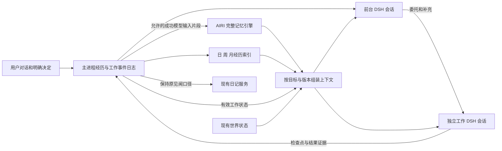

# 连续协作者、AIRI 记忆与上下文的统一升级计划

日期：2026-11-01。分支：`codex/continuous-work-p0`。审计基线：`569b8131a10da02fe14dd772e20c2074669e186d`；main 基线为 `227e759dd403653119587ec68c0976d6ad1155b7`。本轮只有研究文档、来源指纹与纯函数特征实验，未修改产品运行时。

**本文件作为后续实施顺序的统一入口。** [持续工作计划](lca-continuous-work-plan-20261031.md) 保留官方原型、工作状态机、授权和投递的详细设计；[AIRI 直接复用评估](airi-memory-direct-reuse-20261101.md) 保留来源版本、完整迁入清单与历史测试证据。此前将日记、生活一起重构的顺序被本计划替代：**这一波不改日记行为；世界泡保留现有行为并检查接入兼容，重点是完整记忆迁入与连续协作。**

## 1. 先校正对现状的理解

用户希望的是：工作时仍是同一个桃子，聊天不中断；新决定能影响正在做的事；做完立即知道成果，隔天或隔周仍能回忆；原有生活和日记能够接在同一段经历上。这一目标与此前的“两条车道”比喻一致，但不能直接按旧实现继续补丁。

| 用户描述 | 当前代码实际行为 | 对本次设计的影响 |
| --- | --- | --- |
| 之前的天变成 compaction，更早压得更狠 | **跨日日／周／月摘要仍在；日内 compaction 是另一层。** 前者由 `memory/service.ts` 和 `hierarchy.ts` 管理，后者实际模型会话由 DSH 管理 | 拆清日历经历索引、工作上下文压缩、长期记忆，不能互相替代 |
| 日→周→月逐级压缩 | 周与月目前都**直接从日摘要**取材料，月并不再压周；同一个摘句器，每次最多 16 段、每段最多 240 字 | 远期是覆盖更广、细节更少的投影，不是完整的多级语义记忆 |
| 昨天所有内容都有日摘要 | 日摘要只取该日允许记忆片段的最后 24 段，输入再受 28,000 字节上限限制；一天只生成一次，不能代表完整日史 | 保留原历史；升级后需要覆盖游标和可更新的日回顾，未覆盖部分不能标成已总结 |
| 工作前压缩并冻结聊天 | 这是旧心流的部分机制。旧版只冻结人格与**已有** compaction，再带最近 12 条、每条最多 500 字；并非入场时自动完整总结聊天 | 保留稳定身份，补齐任务相关的决定；不能复活旧心流的截断方式 |
| 工作完成，工作摘要注入，聊天复活 | 旧版退出主要带文件／命令证据，不是完整目标、决定与原因的语义交班。1.1 起旧心流退出，当前聊天与 coding 已在**同一个 DSH 根会话**；工作中消息以 `steer` 进入同一轮 | 新方案需要真正分开执行上下文，同时保留持续的前台对话；无需在结束时恢复整份聊天 |
| 现在能跨工作上下文承接当天聊天 | 目前按“日会话 + 项目目录”保存 DSH root。换项目时补本日该 root 未见的用户／合格角色发言，最多 40 条、12,000 字；不是任务交班摘要 | 工作身份要独立于日页和项目选择；同日补话不等于持续任务 |
| 日记、世界泡与记忆是一体的 | 它们共享部分日志与调度，但输入不同。日记读见闻片段；世界状态由代码投影进开轮引用；长期记忆抽取使用更窄的允许片段 | 共用可追溯经历与引用，保留用途差别；日记不能变成事实库 |

现状依据：[DSH 执行与开轮引用](../../src/main/dsh/execution.ts)、[摘要服务](../../src/main/memory/service.ts)、[层级选择](../../src/main/memory/hierarchy.ts)、[摘要校验](../../src/main/memory/model.ts)、[旧心流审计](context-continuity-audit-20261019.md)、[1.1 发布记录](../releases/1.1.0.md)。以上在本轮重新核对源码，旧审计只用于辨认历史。

### 1.1 当前分日／周／月机制的边界

- 日页以北京时间 04:00 分界，实际翻页等待空闲、非忙碌、计时等条件。当前 `memory` 服务同时负责抽取、摘要、日切和旧压缩，迁移时必须拆分职责，不能删除服务时连日页一起删掉。
- 选入新 DSH root 的 `previousDaysReference` 最多 12 项、合计 32,000 **字符**。优先近期日摘要（窗口从今天减 6 天起、最多 7 槽），更早可用周／月覆盖；周覆盖的每个来源日须早于今天减 7 天，月须早于减 30 天。同一来源会话不重复代表。
- 摘要在新 root 第一次发言时注入；后续开轮按最近三条用户发言做记忆检索。`steer` 不重建开轮引用。不是每个模型步骤都重读最新记忆和世界。
- 周／月依赖 `parentSummaryIds`。子摘要被新版本替代会使旧上级摘要失效；但**记忆事实更正与摘要更正尚无共同版本联动**。缺失的父摘要目前按 unknown 接受；裁短文字也不调整覆盖元数据。
- 摘要是未经审核的引用。原始日志不因压缩被删。它们能提供时间脉络，但目前存在摘句遗漏、跨日静态注入和“历史表述被当成当前事实”的风险。

### 1.2 当前存在两套日内压缩接线

DSH 的基础配置挂载 `dsh-compaction-basic`、token meter 和工具结果修剪器；其原生 compaction 把较早、工具调用与结果配对完整的历史替换为摘要，保留近期内容。它还有手动 `compactNow` 接口，原始日志与模型可见投影分开。

LCA 的 `/compact` 与 `context.compact` 却仍在 [controller](../../src/main/bridge/controller.ts) 被送到旧 `memory.dispatch`：在应用日志写 `context/compact`，更改 LCA 的 `contextEntries`。当前 DSH 的 `referenceFor` 不消费这份 `conversationSummary`，bridge 也没有转发原生 compact 的命令。**因此现有手动命令没有对正在使用的 DSH 历史执行压缩。** 这是源码调用链结论；本轮没有跑一次真实模型压缩，也不据此断言用户曾遇到的溢出由它造成。

升级时明确只有 DSH 拥有各 root 的模型历史压缩。手动命令必须指明目标并返回实际压缩、无可压范围、忙碌或失败结果；旧日志仍可读取，停掉重复的旧压缩调度及误导性的状态统计。原生压缩调用的额度、模型路由、取消、来源退役和重启也要单独验证，不能只证明桥收到了命令。

## 2. 统一设计：共享经历，分开执行，按用途生成上下文

图中日记是单向消费者，无反向事实通道；图中各条线均经过现有来源和作用域投影，不表示所有日志文本可直接送给所有消费者。AIRI 中的 dream / reflection 是记忆维护算法，也不等于 LCA 的日记或虚构生活；迁入后仍受输入来源与派生内容规则约束。

| 部件 | 回答的问题 | 保存／使用什么 | 不承担什么 |
| --- | --- | --- | --- |
| 经历与工作日志 | 当时发生了什么，有什么证据？ | 用户原话、获准见闻、工作状态变化、来源 ID 和回执；追加保存 | 不把模型口头“完成”记为已验证产物 |
| 前台 DSH | 现在与你聊到哪里？ | 角色身份、近期对话、自己的 DSH 摘要、当前相关记忆与任务卡 | 不承接整段后台命令输出 |
| 工作 DSH | 这件事接下来怎么做？ | 目标、决定、当前步骤、所需资料与工具历史；DSH 自行压缩 | 不复制整段陪伴关系史，不因闲聊换目标 |
| 日／周／月经历索引 | 我们那段时间经历了什么？ | 有日期、覆盖范围、来源和版本的回顾，可按 ID 展开 | 不承诺保留所有细节，不作为当前事实权威 |
| AIRI 记忆 | 哪些已知信息与眼前这句话有关？ | 原引擎的事实／经历、作用域、修订、语义召回、衰减晋升、向量与镜像 | 不维护工作是否完成，不代替 DSH 的上下文窗口 |
| 工作状态与订阅 | 那件事做到哪了，新消息该交给谁？ | 稳定 workId、运行代次、目标版本、检查点、待决问题、交付与订阅 | 未完成义务不能随时间摘要被压没 |
| 世界泡 | 她现在在哪，生活里发生了什么？ | 现有代码确定的地点、外出和物品；虚构与实际产物分开 | 不凭工作摘要声称停机期间实际做事 |
| 日记 | 她怎样主观回顾那一天？ | 现有见闻选择、写作、加密和解锁规则 | 本轮不改；内容不反向进入事实记忆 |

这不是再做一套记忆引擎。新增加的是 LCA 的经历索引、上下文适配与任务交接；事实抽取、检索、纠正、向量生命周期和镜像仍以完整 AIRI 实现为主体。

## 3. “两条车道”如何具体衔接

### 3.1 开工：冻结稳定身份，目标和事实带版本

前台保留自己的对话，不在开工时切换为工作聊天，也不清空。创建 workId 后交给独立 root 的内容分为两部分：

- 稳定前缀：同一角色配置和基本表达约定，带 personaVersion。复用 P0 已修复的“按 root 捕获人格”接线。身份可以稳定，权限、时间和任务事实不能冻结。
- 任务包：目标、完成标准、用户原话／决定 ID、项目与范围、当前约束版本、相关 AIRI 记忆引用、必要的近期经历、已允许资料引用。模型生成的背景概述与确定的目标／决定分开标记。

前台负责把用户的意思交接清楚；Worker 读到的不是一份凭空改写的提示。用户刚说的“别改某处”“先做哪项”和目标本身必须可回指，不依靠相似度检索才找得到。此前做过的相关工作按 workId 找状态，再按需要展开证据。

### 3.2 工作中：聊天继续，修改及时送达

前台先回应闲聊；只有明确关联工作的补充才成为 work update。同一工作的新事件通过订阅直达，不要求前台反复解释。含歧义且会改变执行的指代才做一次具体澄清；“刚才那件事”不能一律送给最近的 Worker。

用户补充先持久化目标／约束 revision，再发稳定事件 ID。Worker 在下一模型步骤／尚未发出的受影响动作前应用增量；先核对版本，取消或重算旧计划。不谎称已经发出的外部动作能被撤回。停止和撤权独立于普通事件队列。

前台同时维护一张简短的当前工作卡：正在处理什么、做到哪、最新决定、有无问题。正常 progress 不重复生成“经历”；只有实质状态变化才更新。这解决“尚未做完，聊天里就已经不知道自己在干什么”。

### 3.3 完工：交付检查点回流，聊天一直存在

回传字段建议固定为：`workId / revision / objective / userDecisions / verifiedChanges / checks / unresolved / nextStep / evidenceRefs`。其中 `verifiedChanges`、`checks` 来自实际回执；“原因／判断／建议”可由模型表达并保留来源。未完成与不确定事项明确保留，Team 看板完成或 turn 结束都不能单独算交付。

前台拿到耐久检查点后，用同一角色自然说明结果。用户问“刚才改了哪儿，为什么这么改”时直接读这份检查点；需要细节再读关联记录，**不等待日总结或 embedding 队列完成**。同一结果只交付一次；原始工作日志留在工作 root。

用户在工作中表达的偏好、决定、以及符合现有规则的交流片段可走 AIRI 抽取。程序结果进入工作事实库；自动交班摘要、前台转述、日回顾、召回文本不再次冒充用户经历。模型不得仅因摘要出现过“测试成功”就新记一条事实。

`execution.ts` 的成功输入采集与 `memory/seen.ts` 要保留原始 eventId、实际发言者和派生关系：同一句用户决定送到前台与 Worker，是同一个经历的两次消费；任务包引用不能被重新识别为第二条用户原话。兼容旧日志的读取保留，新格式不靠文本相等来跨 root 去重。

### 3.4 第二天、下周与很久以后

进入新前台会话时，携带当前未完工作的有界状态、近期经历索引、相关 AIRI 记忆和当前世界状态。对于正在进行的工作，精确状态查询优先于向量回忆；对于“之前为什么选这个方案”，按经历／工作引用查决定；对于“我平时喜欢什么”，用有修订和作用域的 AIRI 事实。

分日／周／月仍保留，但**不再靠它独力保存所有身份和义务**。日回顾覆盖原片段与工作检查点的引用，周／月是导航性的主题与时间概述；丢失细节可以回读，不在压过的短文上反复继续猜。旧摘要保留兼容；首版保留周、月直接从日回顾取材，避免再引入一轮串联损失。

## 4. 上下文与更正：必须同时解决“想起”与“用对”

### 4.1 一个组装入口，多种有边界的材料

从当前 `index.ts` 的 reference 回调拆出 main 拥有的 context composer，接收目标 root 的角色、workId、输入、版本与模型容量，返回有界引用。它只适配现有服务，不拥有新的 agent loop 或记忆算法。

优先顺序建议为：当前用户消息／约束、角色与当前时间、当前工作状态、近期对话、相关且有效的 AIRI 记忆、近期经历、较远回顾。当前约束和未完成事项不得仅因历史变旧而被裁掉。引用详情超限时用目录和 ID 展开；不把省略内容算成已经让模型读过。

容量以实际 chat／work 模型窗口扣除系统、工具、输出和运行余量后统一分配。保留内部条数与字符上限，但不把“12 项摘要 + 若干向量结果 + 所有任务卡”各自用满后直接拼起来。在一个 root 里，只有 DSH 改写模型历史；日历索引与 AIRI 提供材料，不再额外对整份会话做第二次 LCA compaction。

不每一步全量重发同一目录、旧摘要和工作卡。首次注入后保存 revision 水位；发生更正／新决定／来源撤回时在安全步骤边界发增量。DSH 压缩后，依靠可查询的当前版本恢复必要约束，而不是盲信旧摘要仍完整。频繁变化的访问次数不应扰动稳定目录前缀。

### 4.2 历史正确，不代表现在仍然正确

例子：周一说“报告周五交”，周三改到周六。

1. 原话和周一经历保留，不能改写历史。
2. 当前事实由 AIRI 的修订／supersession 表达，当前工作约束升 revision，旧值不得再用于安排交付。
3. 关联日回顾、目录、工作卡和上下文缓存标记需刷新；在刷新完成前，用“当时计划周五；现改为周六”的有效更正覆盖或暂不注入旧当前断言。
4. 新版摘要声明具体来源与父版本。父版本变化失效并按需重建；缺父时不把不明覆盖当成当前事实，允许通过明确历史引用回读，而非一概使聊天失败。
5. 来源撤回／忘记与普通事实更新分别处理：撤回抑制派生注入和重新抽取；普通更新允许历史回顾保留当时状态。全部原始历史仍按存档政策保存。

引用至少带 owner、source／event ID、revision、发生时间／有效时间、用途和派生关系。字段由已有来源、记忆与工作类型适配，不另造允许任意来源混写的通用知识图谱。检索命中、注入成功、回答实际使用、动作遵守分别留证据，不能把 recall@3 当成全链路质量。

## 5. 完整 AIRI 迁入与持久性安排

沿用 `mods@3a84a4fbaf6a54defe385e050be86fcb5436745b` 固定基线，保留领域、DuckDB SQL／schema、双路语义检索、纠正、晋升、dream／reflection、向量元数据与迁移、pgvector outbox 和原测试。当前 AIRI 未提交的目录与交互／V3 修复作为固定指纹的独立补丁集。具体清单见 [直接复用评估 §4–6](airi-memory-direct-reuse-20261101.md#4-哪些直接保留哪些必须适配)。

LCA 的 owner 为用户＋角色＋数据根；工作再附 project／work 作用域。日页 ID 只表示时间分段，不能每翻一页就变成新的长期记忆身份。DuckDB 和向量宿主由 main 控制，界面不承接 AIRI 浏览器 leader／OPFS 业务；镜像用 LCA 独立数据空间和配置。

当前 `memory.sqlite` 只是 append-only 日志投影。迁入不能让日志与 DuckDB 对同一记忆各自宣称最新。建议增加**薄的写入协调器**，不重写 AIRI 仓储算法：

1. 在 LCA 日志记录含稳定 operationId、来源和预期 revision 的操作意图，意图不等于成功。
2. 保留原仓储事务；在同一事务提交可恢复的 operationId 结果／待发布回执与现有镜像 outbox。能否覆盖原调用链中的多次写入，是 M1／M2 要实际验证的宿主契约。
3. 将已应用变更写入 append-only 完成记录（足以恢复事实和修订，不把向量反复写进日志），之后再向前台和镜像发布。未发布期间相关写入不冒充已完成；启动先按 operationId 对账，不能重新调用模型猜测原结果。
4. 在“意图后／数据库提交后／日志完成前后／镜像确认前后”注入中断。若选定驱动不能提供所需事务能力，调整适配层再接产品，不把跨库两次写成功称为原子提交。

这一协调器的成本在恢复实验中检验，避免凭设计增加多层防御却没有可工作的正常路径。正常写入、纠正与查询必须先有正例，再验证故障。

旧记忆迁移保留来源 ID、审核状态、已替代链、抽取水位与取消／忘记信息，不把 unreviewed 自动升为 approved。历史全文不会为“补齐记忆”直接重新抽取；如需重建，只能取原先获准的成功输入，并单独计成本。旧日／周／月摘要迁入经历索引，不伪装成 AIRI 原始事实。

先影子读取做对照，生产只选一个写入引擎。旧抽取器关闭后仍保留历史兼容读取；回退不删除新记录，也不让两套引擎继续互相抽取。备份版本按持续工作计划升级，纳入 DuckDB 一致快照、embedding 指纹、操作水位、记忆修订与墓碑、工作事实；不复制 DSH 执行批准、外部项目和凭据。恢复后旧 mirror outbox 先与新 restore epoch 对账，防止旧队列覆盖恢复结果或复活已删事实。

## 6. 日页、日记与世界泡这一波怎样保持兼容

**工作与日页先解开身份，再解开调度。** workId／runId 不依赖当前日页，但首轮保留既有 04:00 和忙碌／计时翻页门槛：后台忙时允许暂缓翻页，不能为了换页杀任务。暂停后翻页、次日继续、重启核对均通过稳定 workId 恢复。前台实际时钟照常更新，不能因为还在旧页就自称昨天。后续若要求活动 Worker 期间也立即翻页，需要独立拆开 `closingDay → sleep → cancel`，属于另一个生活调度改动，首轮不暗中实施。

**不动日记包含输入与调度，不只是文件不改。** 保留其过去三天已结束日的材料窗口、当前选材、尝试记录／手动重试、加密与解锁规则；保留原有 foreground 中断与等价的 aggregateBusy。前台空闲而 Worker 仍活跃时，不能让它误判成旧语义下的全局空闲。工作原始轨迹不批量送给 diary 的 `seenFragments()`；公共对话仍走既有见闻口径，新内部报告保持内部。新的见闻类型不自动扩展日记材料范围。

这不承诺日记写出的文字与以前完全相同，也不解决用户所说“从未感觉它触发”的旧问题。它保证这一波不改写作规则、不扩大材料类别、不增加尝试频率、不变更解锁产品行为。此前发现的触发／中断断点保留在历史审计中，后续专门处理。

**世界泡当前状态照常进入前台，Worker 按相关性获取。** 当前 `worldReference` 带位置、最近三次外出／物品和最近六项生活工作元数据；现状不含完整实际作品。新 composer 保留这条通路，区分虚构生活、真实任务产物和模型表达。首轮不改散步窗口、不补新的生活材料生产者，不把 coding 任意输出自动投喂生活创作。

以后要让世界泡、日记活起来，可以消费同一经历和检查点，但需要单独确定“哪些经历、何时生成、怎样让用户感知”。当前预留清晰接口即可；不会为了本轮完整记忆而同步重做这些产品流程。

## 7. 合并后的施工顺序

原 P0–P6 与 M0–M5 是两张详细清单，下表统一安排依赖，不要求两套大型改造一次上线。内部分支开关可比较新旧，用户界面不增加一排工程开关。

| 批次 | 实施与具体落点 | 退出条件 |
| --- | --- | --- |
| U0 现状与契约（本轮） | 本文、纯函数日历实验；明确经历、事实、任务与日记的用途，固定源码。下一步先做接口草案，放 `src/shared/` | 当前／旧版／建议不混写；7 项特征实验通过不算新架构通过 |
| U1 原引擎隔离宿主（原 M1–M2） | 固定 AIRI 代码与许可，抽出既有 memory 编排；main 控制的 DuckDB／embedding 宿主；补 operationId 与 Clock 适配 | 原测试迁入并通过；开库、写入、checkpoint、重开和中断恢复；驱动／Windows 打包问题先有具体结果 |
| U2 单会话先接完整记忆（原 M3–M4 的接线） | `memory/service.ts` 拆成 AIRI 接口、经历索引与日页协调；`seen.ts` 接来源身份；独立 `context` composer 接 `index.ts`；旧摘要先兼容；`controller`／host／bridge 接真正的定向 compact；记忆浏览、纠正与独立向量配置 | 当前单 root 下，普通问法能召回且修订生效；当前决定不等后台抽取；原始历史、世界与日记输入不退化；备份、镜像和迁移通过后才称完整迁入 |
| U3 交互／执行与任务持续性（原 P0 剩余门槛、P1–P3） | 完成 root 角色／额度探针；`work/{journal,projection,service,delivery,subscriptions}`；拆 `execution.ts` 单例；host／bridge 绑定 role、workId、运行代次 | 正在工作的真实 DSH 合成工具阻塞时，前台完成交流；更新进同一工作；停止命中正确 root；工作跨暂停、日页和重启保留 |
| U4 两车道上下文与经历回流（原 P4–P5、M3 的组合） | 开工任务包、增量决定、检查点、前台交付；完善日回顾覆盖／版本、周月索引和更正失效；对新旧 root 的来源退役一致处理 | 本文 T1–T16 通过；无重复交付／递归记忆／旧事实回流；日记与生活兼容性成立；省略内容可按引用补读 |
| U5 综合验收与退役（原 P6、M5） | 原 AIRI 评测和原持续工作强基线，组合矩阵、故障恢复、候选包、获授权的真实日用 | 离线结构正确与真实质量分别有结论；以完整迁移／回退证据退役旧引擎，不带实验任务直接合入 main |

**紧接本轮的第一项实施仍是 U1：让原 AIRI 引擎在隔离宿主运行。** U0 的接口草案与 U1 一起明确 source／revision／operationId；共享接口单独用“接口：”提交。U2 先保持一个 DSH root，使记忆回归可定位；U3 再分执行。原计划的连续工作核心没有取消，也没有被顺手修日记挤掉。

## 8. 测试方案：同一个故事跨聊天、工作、日页和记忆

第一条整体验收脚本：

> 周一聊天说明“字体设置别加独立分区”，随后委托改设置。工具保持未完成；用户插话聊晚饭，前台正常回应，并知道自己还在改什么。用户补一句“字号也能独立调”；同一 workId 收到新版本。工具完成，测试回执生成，前台解释改动和原因。立刻问“刚才改了什么”，不等日总结也能回答。隔天问“为什么这么排版”，能按经历和工作引用找回决定。一周后用户改偏好，旧周摘要仍保留当时选择，但当前建议用新偏好。最后恢复存档，记忆一致，工作状态先核对，没有自动重做。

先用脚本模型走现有本地接口→真实 DSH→隔离 Electron，检查实际请求与产物；之后同样的问题交给获授权真实模型。脚本不能直接注入最终答案来冒充回忆，金标准独立保存。

| ID | 场景与需要看到的正例 | 关键断言／证据 |
| --- | --- | --- |
| T1 | U2 单 root，跨会话自然问法找回偏好 | 保留 AIRI 原 90 条、九层样本；注入来源与答案使用分开记，不只查数据库有行 |
| T2 | 工作未完成时闲聊 | 测试屏障保持工作工具未释放，前台已给出有效回应；workId／目标未变；单请求 provider 的等待单列 |
| T3 | 工作中修改目标，再问进度 | 更新先耐久，再被同一工作消费；下一受影响动作使用新 revision；前台卡片与工作状态一致 |
| T4 | 做完马上回忆，不等抽取和日切 | 能回答目标、用户决定、实际结果与未解决项；引用检查点，不能仅泛答“完成了” |
| T5 | 同时多项工作与模糊指代 | 已知订阅直达正确 work；歧义保持待澄清，闲聊不变成修改另一项工作 |
| T6 | 日切、周/月选择、两个月后相关旧事 | 原始历史仍可读；覆盖无重复、无虚报完整；当前未完任务不被年龄淘汰；精确细节通过 ID 找回 |
| T7 | 新偏好纠正旧事实，但旧周/月摘要还在 | 当前事实、目录、任务约束都用新 revision；历史问题仍可回答当时值；旧当前断言不复活 |
| T8 | DSH 自动与手动压缩，含成对工具调用 | 实际模型请求缩短且近期约束保留；指定 root 独立；原日志完整；忙碌／无可压范围如实返回 |
| T9 | 压缩后再撤回来源／更正事实 | 原文、摘要、工作报告及前台转述继承来源状态；下一请求不能因 compaction 洗掉来源限制 |
| T10 | 同一信息经过 Worker→前台→日回顾→召回 | 用户经历只按原来源抽取一次；自动报告不是新用户事实；允许的真实决定仍能正常记住 |
| T11 | task 投递／记忆写入各提交边界中断 | eventId／operationId 幂等对账；不重复产物或交付；未确认外部结果不盲目重放 |
| T12 | DuckDB 重开、向量切换、镜像掉线与删除后重投 | AIRI 原测试＋LCA 宿主恢复；维度／指纹不混用；本地可检索；旧 outbox 不复活已删内容 |
| T13 | 非空 `.lca-save` 导出恢复及旧版本升级 | 事实 ID／来源／revision／向量一致，工作转待核对；新 epoch 不接旧批准；历史日页／日记可读 |
| T14 | 日记／世界泡兼容对照 | 等价输入时原可写／不可写条件、材料类别、尝试次数、取消与解锁相同；后台 root 不伪造全局空闲；虚构生活不冒充真实工作 |
| T15 | 用户、角色、项目和数据根切换 | 允许范围内能继续同一工作；跨 owner 不串人格、记忆、卡片、向量或镜像；无需重装应用才能正常切回 |
| T16 | 失败与退化：镜像无配置、embedding 暂时不可用、摘要失败 | 前台仍能使用有效当前状态和近期对话；服务状态可解释、不静默切回旧引擎；遗漏回忆不伪装已检索；后台维护可恢复 |

### 8.1 对照与通过标准

先做 **2×2 定位矩阵**：A=现有单 root＋旧记忆，B=单 root＋AIRI，C=分离执行＋旧记忆，D=分离执行＋AIRI。先跑低成本固定请求与状态测试，定位收益来自哪一部分；不要求一次做完整付费矩阵。持续工作原文的 B1 明确委派、B2 强制委派，以及去直通／去按需引用消融继续保留，不能仅赢弱基线就归功于新架构。

所有质量组固定相同模型、问题、可用资料、上下文总额度和任务时序。跨日／周用 ManualClock，模型采样不能固定时记录参数与重复次数，不宣称完全可复现。AIRI 原 90 条检索样本保持原样，用作可比基线；另预先冻结 24 条中文多回合故事（偏好、更正、决定理由、刚完工、长期任务、未知问题各 4 条），分别标注应回忆来源、允许答案和实际动作约束。新增样本不能反复挑到 D 获胜才保留。

必须同时报告：检索准确／遗漏、事实是否被答案采用、工作是否遵守约束、未完成状态是否记住、错误或过时断言、前台响应／任务交付 P50/P95、输入／缓存／输出 token、embedding 次数与耗时、后台摘要调用、包体／启动／内存／镜像积压。风格连续性用同一批聊天和交付回答做匿名人工评分；人格配置相同只能证明接线，不证明“像同一个人”。

工程门槛：T2 屏障顺序、T3 版本、T4 证据、T5 路由、T7–T15 的关键不变量全部通过；原 AIRI 固定向量回放在同配置下保持结果等价，差异必须解释。质量上优先要求有效回忆、当前决定和真实任务成功率不退化；小样本不能分辨则记“不确定”。前台速度的原有数值门槛仍是预注册候选，正式服务实验前才固定，不当成承诺。

各层单独交付证据：纯函数与原单测 → 实际 DSH 合成流程 → 隔离 Electron／独立 DuckDB 与镜像数据库 → 候选包／Windows 重启／存档 → 获授权真实模型与向量模型 → 日用跨日观察。镜像数据库测试、合成模型通过、旧 AIRI 实机通过均不能替代新 LCA 实机结论。

## 9. 本轮实际完成和下一步

- 已重新核对当前与旧上下文机制；定位旧 `/compact` 未接 DSH、日回顾覆盖有限、事实更正与历史摘要未联动等接入问题。
- `node scripts/research-context-hierarchy.mjs` 在 Node 24.14.0 执行 **7/7 特征案例**：周／月取材、年龄边界、近期与远期去重、父摘要替代、外部事实更正边界、缺父行为和字符裁剪。它描述现状，包含要改善的行为，不能称新设计验收通过。
- [证据快照](evidence/lca-continuity-memory-context-20261101.json) 保存案例结果及 19 个源码／运行时文档指纹；原始本机报告为 `test-results/context-hierarchy/audit-iRjgJH/report.json`。
- 未安装主工程依赖、运行完整单元／Electron 测试、触碰日用 profile、启动 AIRI／Docker 或调用任何模型。本轮未重新执行 AIRI 历史验收。

下一步交付 U1 的隔离宿主与原测试迁入结果，随后 U2 先证明完整记忆在当前单会话下可用，再推进两车道和组合验收。这使每次改动都有可定位的正常路径与回退点，同时保留整个连续协作者目标。
