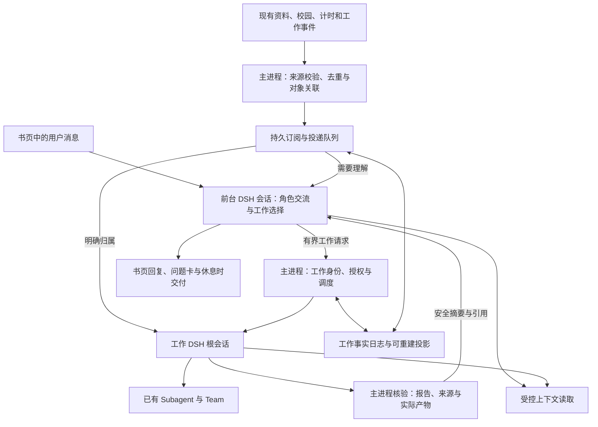

# LCA 持续工作改造：官方 Super-agent 原型研究与实施计划

日期：2026-10-31。状态：**架构方案待实施，P0 已在独立实验分支开展部分验证**。最初请求是深入研究官方原型，并制定交互与执行分离、任务持续性、事件订阅和上下文管理的具体改造计划。

后续按用户要求，从当天已合并 1.2 改动的 `main@227e759dd403653119587ec68c0976d6ad1155b7` 建立独立 worktree 与 `codex/continuous-work-p0` 分支，迁入本文及研究清单。下文源码研究基线仍为当时的 `b4f1183`，该提交是这次 main 合并的第二父提交，相关 main / shared / bridge 源码无差异。初步运行结果、并发人格隔离修复与剩余门槛见 [P0 实验记录](lca-continuous-work-p0-20261031.md)；不把局部探针通过解释为 P0 全部完成。

建议路线：**M4，参考官方机制，在 LCA 内实现工作生命周期与受控路由；DSH 继续拥有全部模型 / 工具执行循环。** 最高影响等级为 F3：会话职责与授权生命周期变化，需要作为独立架构改造推进。本文把产品选择、接口、实施顺序与验收做成可评审方案；研究授权不等于默认启用这些行为，也不授权真实模型、学校扫描或外部写入。

## 1. 结论与范围

目标体验：桃子能够继续与你交流，已经接受的工作在独立 DSH 上下文中推进；后续消息找到同一工作；重启后知道做到哪里；结果和问题按书页、专注与休息的既有节奏交付。

优先建设四项能力：

1. **前台会话与工作执行分离。** 前台负责角色表达、理解请求、选择工作、交付结果；重工具进入独立工作根会话。工作内部仍可用已有 Subagent / Team。
2. **工作身份独立于聊天回合和日页。** 保存目标、范围、来源引用、执行绑定和结果证据。暂停、结束回合、失败、停止与完成分别表达。
3. **持久事件投递与明确订阅。** 已知工作收到相关对象的新事件；新事项进入有界研判。重复、迟到、来源失效和停止后的事件不能重新授权执行。
4. **按需上下文。** 前台获得有界任务卡与有效引用，工作获得完成该任务所需的输入；每次展开引用都重新检查作用域、版本与原文权限。

第一版保持本地 Electron / DSH 架构、现有项目原地工作和书本入口。云端常驻、远程 daemon、GitHub / 飞书新接入、自主修复 Watchdog 和跨项目并行不进入本次最小实现。已有校园与资料处理流水线继续拥有其执行状态，不能再派一个 Worker 重复整理同一资料。

同日用户进一步要求参考其改造的 AIRI 替换轻量记忆，并让世界泡与日记在正常使用中实际发生。因此，长期记忆更换、生活活动与日记现已纳入实验分支，具体审计、顺序与体验验收见 [综合探索计划](lca-character-continuity-exploration-20261031.md)。本文的交互 / 执行、任务、事件与上下文四项能力作为共同底座，原有 P0 证据边界不变。

## 2. 研究基线和证据边界

| 项目 | 固定基线 |
| --- | --- |
| 官方原型 | [deepseek-ai/dsh-superagent-prototype](https://github.com/deepseek-ai/dsh-superagent-prototype/tree/6337fc823ce20251c8de8085948165c81aaa701e)，commit `6337fc823ce20251c8de8085948165c81aaa701e`，源码包版本 `0.1.0` |
| 上游定位 | README 明确是研究原型；公开版与内部实例及文章不完全一致。单 GitHub 仓库，可选飞书。不是 DSH 正式产品功能清单 |
| 上游依赖 | `engines.dsh: ^0.2.1-alpha.2`；开发依赖固定 `0.2.1-alpha.2`；包含 Web UI 服务、CLI、SQLite、部署脚本等假设 |
| LCA | 分支 `codex/1.2-development-plan`，HEAD `b4f1183fd35227061ffaa1264ef70ef119448a7a`；工作区已有其他研究改动，未覆盖 |
| LCA 运行时 | `@deepseek-ai/dsh 0.2.1-rc.2`，Electron `44.7.0`，pnpm `11.24.0`；`package.json` 版本仍为 `1.1.0`，候选验收记录另见 rc.3 文档 |
| 文章 | 用户提供的《Super-agent 设计探索：迈向更自主的 Agent 系统》正文与 14 张图；原微信页面未直接读取 |
| 源码研究阶段实际证据 | 上游固定 commit 的源码、相关测试源码、LCA 当前源码和设计文档；来源清单与本地 SHA-256 见[研究证据索引](evidence/lca-continuous-work-research-20261031.json) |
| 未进行 | 原型安装、依赖安装、上游测试执行、LCA 运行时改造、模型调用、校园扫描、外发、打包与安装验证 |

原始研究阶段属于迁入规格 E0 源码研究；后续 P0 本地合成证据另列，不扩大原始清单的结论。上游有测试不能写成我们运行通过；当前 LCA 的历史验收也不证明新方案已成立。源码版本范围看似接近不构成 DSH API / Electron ABI / Windows 兼容证明。

## 3. 官方原型真正实现了什么

### 3.1 输入、分派、执行与回执的代码链

`Source → Engine.receive → Intake → Subscription fan-out / Eval → Ticket + Mandate → Assignment → Effects → DshExecutor → DSH Session → Report → Router / Outbox`。

这条链有三个值得保留的职责分离：事件进入不等于授权；任务状态不等于会话是否正在推理；消息发出不等于对方已经处理。

| 机制 | 固定源码依据 | 对 LCA 的判断 |
| --- | --- | --- |
| 输入去重、订阅扇出 | [intake.ts](https://github.com/deepseek-ai/dsh-superagent-prototype/blob/6337fc823ce20251c8de8085948165c81aaa701e/src/core/intake.ts)：按 Trigger ID 去重；关联 Thread；向订阅 Ticket 加 Input；没有归属的消息入 Eval | 保留这一处理次序；LCA 加来源版本和用户 / 角色 / 项目边界 |
| 任务与执行分开 | [engine.ts](https://github.com/deepseek-ai/dsh-superagent-prototype/blob/6337fc823ce20251c8de8085948165c81aaa701e/src/core/engine.ts)、[tickets.ts](https://github.com/deepseek-ai/dsh-superagent-prototype/blob/6337fc823ce20251c8de8085948165c81aaa701e/src/core/tickets.ts)：Ticket 可经历多个 Assignment，Worker Session 不决定全部业务状态 | 保留独立工作身份；DSH Team 子任务仍归 DSH |
| 先持久化再执行 | [effects.ts](https://github.com/deepseek-ai/dsh-superagent-prototype/blob/6337fc823ce20251c8de8085948165c81aaa701e/src/app/effects.ts)：事务内写 effect，提交后执行；`seq + generation` 防旧尝试覆盖新队列内容 | 借鉴稳定 ID、代次与延后执行；适配 LCA append-only 事实源，不另建互相竞争的业务真相 |
| 投递去重和落盘屏障 | [delivery.ts](https://github.com/deepseek-ai/dsh-superagent-prototype/blob/6337fc823ce20251c8de8085948165c81aaa701e/src/app/delivery.ts)：稳定 MessageId，核对历史和两个 inbox，最后 flush；来源为插件 relay，区别于真人发言 | 必须补进 LCA 新协议；不能只依赖 IPC 写入成功 |
| 实际消费与投递分开 | [dsh.ts](https://github.com/deepseek-ai/dsh-superagent-prototype/blob/6337fc823ce20251c8de8085948165c81aaa701e/src/executor/dsh.ts)：Inputs delivered/read、turn ended 分开；恢复处理未被步骤真正取用的输入 | 保留；“已送达”“模型看到”“工作完成”分别留证据 |
| Worker 槽位与后台工作 | 同上及 [background.ts](https://github.com/deepseek-ai/dsh-superagent-prototype/blob/6337fc823ce20251c8de8085948165c81aaa701e/src/executor/background.ts)：后台 job / subagent 仍占执行槽，完成结果唤醒 Worker；人为介入优先 | 借鉴；LCA 的全局容量、预算和熄灯规则优先 |
| 有界对象图 | [cards.ts](https://github.com/deepseek-ai/dsh-superagent-prototype/blob/6337fc823ce20251c8de8085948165c81aaa701e/src/app/cards.ts)、[resources.ts](https://github.com/deepseek-ai/dsh-superagent-prototype/blob/6337fc823ce20251c8de8085948165c81aaa701e/src/app/resources.ts)：任务卡、邻近事件、关联 ID、分页全文与 transcript | 借鉴对象引用与分层读取；LCA 不直接开放完整 transcript 给前台 |
| 局部性上下文 | [assessment.ts](https://github.com/deepseek-ai/dsh-superagent-prototype/blob/6337fc823ce20251c8de8085948165c81aaa701e/src/app/assessment.ts)：事件批次、相关任务、Thread 首段 / 邻近消息，额外全文按需读 | 用于相关资料 / 候选 / 工作事件，不先建设全量聊天检索 |

### 3.2 不能从文章直接推导的能力

- **公开 Router 并未硬性禁用 shell。** [sessions.ts](https://github.com/deepseek-ai/dsh-superagent-prototype/blob/6337fc823ce20251c8de8085948165c81aaa701e/src/app/sessions.ts#L262) 保留 `bash/read/job_*`，以 preset、短等待与 `noWait` guard 减少阻塞；避免读代码还有提示词约束。LCA 若承诺前台不被长工作占用，应在工具注册与执行 guard 上落实。
- **原型主动把受管 Session 设为 `danger-full-access`。** 同文件 `ensure()` 第 137–153 行；不能复用其权限预设。LCA 保留按项目沙箱、逐次审批与 D2 来源策略。
- **策略变化主要通知活跃任务。** `tickets.ts:200–207` 把变化送入 Input；已结束任务重新打开才重新核验 Mandate。LCA 撤权必须能在下一次工具 / 模型准入前阻断，不能只给模型一条通知。
- **订阅覆盖 Thread 并不逐条做新任务准入。** 这是上游区分“上下文”与“授权”的选择。LCA 不能让同一话题内的不可信输入借订阅获得用户指令权限。
- **公开读取边界面向一个可信仓库。** `resources.ts` 的 `ticket/` 与 `trigger/` 有归属检查，但 `github/` 原始资源入口不能当作 LCA 私有资料的逐对象权限实现。分页缓存键也没有 LCA 所需的原文授权代次。
- **恢复默认会继续部分中断 Assignment。** 上游用恢复提示要求核对 worktree / GitHub，另有瞬时网络错误的自动续步。LCA 需要将“可安全重送内部消息”与“结果未知的外部动作”分开，不能整体继承自动重试。
- **交付后有些 shell job 可继续存活。** 原型为了供人审阅服务这样处理；LCA 第一版不默认继承脱离任务的后台进程。
- **云端脑手分离、长程记忆、完整自主 Watchdog 不是本轮确认可直接迁用的组件。** 公开原型有 `HealthBoard`、重试和部署检查说明；这些不证明文章设想的分布式自愈已经完整实现。

已阅读的测试包括 `delivery.spec.ts`、`followups.spec.ts`、`background.spec.ts` 与 `runtime-concurrency.spec.ts`：涉及历史去重、flush 失败、停止期间迟到投递、后台工作占槽及 crash 后输入重送。它们是 LCA 故障注入场景的参考，不替代 LCA 的实际接线验收。

## 4. LCA 的真实增量与改动位置

| 当前能力 / 约束 | 现有代码 | 具体缺口 |
| --- | --- | --- |
| 同一主会话接收聊天与事件；忙时 steer，闲时 followup | [execution.ts](../../src/main/dsh/execution.ts) 的 `kick/send/postEvent` | 话题与工作归属不独立，所有事件进入当前 root；队列满只拒绝，缺持久生产者回执 |
| Host 能登记多个 root，身份绑定 runtime / project / cwd | [host.ts](../../src/main/dsh/host.ts)、[identity.ts](../../src/main/dsh/identity.ts) | 上层 `currentScope()`、`onCall/onApproval/onAdmit/onEvent` 只接受当前日页 / 当前项目的一个 session |
| 新 followup 更新家族授权，取消旧子成员等待 | [family.js](../../dsh/lca-bridge/family.js) `begin()`；[index.js](../../dsh/lca-bridge/index.js) `case send` | 闲聊与独立工作共用根时，不能保证后台任务连续；改造应拆根，不能删掉撤销保护 |
| 普通委派、Team、成员回执与冷读取已有接入 | [collaboration.ts](../../src/main/dsh/collaboration.ts)、[collaboration.js](../../dsh/lca-bridge/collaboration.js) | 复用为某件工作的内部协作；需明确前台与工作 root 的控制目标，不能用同一个“当前团队”覆盖所有工作 |
| `send` 创建新的 UserMessage，发送无独立耐久回执 | [host.ts](../../src/main/dsh/host.ts#L264)、[index.js](../../dsh/lca-bridge/index.js#L462) | 缺稳定 inputId、历史 / pending 去重、flush 确认和消费阶段回执 |
| 重启把未完主回合记为 aborted，未投递用户消息记 drop；自动事件可重排 | [execution.ts](../../src/main/dsh/execution.ts#L230) | 工作不能继续借这个主回合恢复语义，需要独立可核对状态 |
| `herBusy()` 同时影响旧页、日记、生活、配置、项目选择、备份 | [index.ts](../../src/main/index.ts#L160) | 前台空闲与后台工作忙要分别表达；不可简单把 busy 改成 false 以放开危险维护操作 |
| 当前日志按日，SQLite 从事实重建 | [session.ts](../../src/main/store/session.ts)、[file.ts](../../src/main/journal/file.ts) | 持续工作需要独立于日切的作用域；保持先事实后投影的崩溃语义 |
| 引用、模型原文与派生内容按成员轮次退役 | [provenance.js](../../dsh/lca-bridge/provenance.js)、[seen.ts](../../src/main/memory/seen.ts) | 新摘要、任务卡、跨 root 报告、续读缓存都要加入同样的来源链 |
| 当前引用含近期对话、记忆、世界与资料状态 | [execution.ts](../../src/main/dsh/execution.ts#L577)、[index.ts](../../src/main/index.ts#L662) | 前台 / Worker 要按角色分别编排；Worker 不继承全套亲密对话与其他项目历史 |
| 备份白名单为四个数据库及登记文件，存档不包含 DSH 原始运行状态 | [schema.ts](../../src/main/backup/schema.ts)、[archive.ts](../../src/main/backup/archive.ts) | 新工作日志需要显式版本化纳入；恢复为历史 / 待核对状态，不能连接存档时间之后的执行 |

## 5. 目标架构与唯一所有者

| 层 | 拥有 | 不接管 |
| --- | --- | --- |
| LCA main | 工作意图、当前授权、来源 / 项目边界、事件收件与订阅、运行时机、预算、核验后的完成状态 | 模型推理—工具—重试循环 |
| DSH | 前台和工作模型步骤、工具执行、工具取消、原始执行日志、内部 Team 任务板 | 角色生活事实、用户授权决定、资料可见性和 LCA 存档 |
| Bridge | root 的角色和工作绑定、步骤 / 工具准入、来源投影、持久消息回执 | 自行接单、扩大项目范围或放宽额度 |
| Renderer | 同一书页中的工作摘要、进度、批准、停止和产物入口 | cwd、密钥、原始工具日志、任意文件读取和任意 root 控制 |

**新增 WorkItem 代表用户委托的一件工作；现有 TeamTask 代表这件工作内的协作子任务。** WorkItem 不复制 Team 的 claim / dependency / complete 状态；DSH 成员 idle、模型说完成、TeamTask 标记 completed 均不能单独把 WorkItem 标记 completed。

前台继续是桃子的表达与关系入口，可使用受限的生活、计时、记忆、资料候选与问题能力。重文件处理、命令、网页操作和长检索交给工作 root。能力分类按实际执行特性审核，不能把全部 `lca_*` 工具一律视为轻量。

## 6. 数据与接口草案

下列是**建议新增**的内部契约，尚未存在。名称与实现可在接口提交中统一，避免与现有 `TaskView` / `TeamTaskView` 混淆。

| 对象 | 核心字段 / 约束 |
| --- | --- |
| `WorkItem` | `workId, owner(userId, characterId), projectKey, titleRef, goalRef, revision, status, waitReason, grantId, latestRunId, resultRefs`；不绑定当天 `sessionId` |
| `WorkGrant` | 用户指令或已配置规则的出处、允许的任务范围、项目、来源引用、预算归属、有效性，以及自主事件共享的 `admissionGroupId`；**只保存做什么的依据，不保存一次性批准** |
| `WorkRun` | `runId, workId, runtimeId, rootSessionId, activationId, state, startedAt, endedAt, endReason`；重启生成新运行代次，历史 run 保留 |
| `WorkTrigger` | `triggerId, producerId, producerEpoch, externalId, sourceRevision, observedAt, owner, projectKey?, topicIds, payloadRef, provenance, intentKind`；正文留在原有受限库 |
| `WorkTopic` | 由来源提供稳定对象 ID，例如资料 job、候选变更链、工作自身；与日页和聊天窗口不同，不能把整个聊天都订阅给一个任务 |
| `WorkSubscription` | `workId, topicId, kind(owned/context), revision, startCursor, status`；关联可用于检索，只有订阅产生投递；停止会封存订阅并留下截止位置 |
| `WorkDelivery` | `inputId, workId, runId?, triggerId?, payloadRef, sourceRevision, grantRevision, state, requestId`；有 durable / in-context / settled 证据，不把 accepted 当消费 |
| `ContextRef` | 类型、opaque ID、版本、来源标签、所属工作 / 项目、用途和有效期；读取授权由 main 核对，ID 本身没有权限 |
| `WorkResult` | 来自实际工具 / 现有领域流水线的产物引用、校验状态、时间和作用域；模型 summary 单列为待核验报告 |

新增代码建议：

- `src/main/work/`：`service.ts`、`journal.ts`、`projection.ts`、`admission.ts`、`delivery.ts`、`subscriptions.ts`、`recovery.ts`、`context.ts`；这些是状态机和受控适配器，没有 LLM 循环。
- `src/shared/work.ts`：安全视图、命令、来源状态、结果状态；`src/shared/dsh-protocol.ts` 升级协议并加入 root role / work binding / inputId / ack。
- `src/main/dsh/execution.ts` 拆分前台投影与多 root 注册 / 回调分派；在改造过程中保持旧入口兼容，逐步替换内部单例。
- Bridge 新增 `work-binding.js`、`delivery.js` 或等价独立模块；已有 family / provenance 规则复用并扩展，而非另设旁路。

用户侧命令建议为 `work.pause / resume / stop / reconcile / followup`，带 epoch、workId 和 expectedRevision；修改仍返回 accepted，完成看后续回执。模型侧只暴露 `work_create / work_read / work_followup / work_report` 等经过角色筛选的窄能力。前台能提交工作意图，Worker 只能报告本工作和请求所需上下文；两者都不能签发自己的授权。

现有聊天模型不可靠发 tool call 时，保留严格文本交接的兼容路线：当前用户回合的一次性凭据 + 完整输出解析 + 严格 schema + main 校验，扩展为“提交工作意图”。普通助手文字、引用、工具结果中的 JSON 永远不解析为控制命令。格式失败保持可见失败，不悄悄改成前台直接执行。

## 7. 四项改造的实现细节

### 7.1 交互与执行分离

1. main 为 root 登记 `conversation | work` 角色。工作 root 绑定 WorkItem；它是独立根，不是前台家族中会被普通聊天换轮一起撤销的孩子。工作内部的子成员仍继承该工作家族边界。
2. 保留前台日页 / 项目的既有连续性投影，工作 root 不再用 `store.scope.sessionId === work.day` 判有效。有效性改查 owner、稳定 projectKey、WorkGrant、WorkRun 和当前角色。
3. 审批、工具、额度、消息和断连按 root 注册表分派；`currentScope()` 只用于前台显示，不能成为全体工作执行的授权依据。host 已有多 root 能力只是基础，不能据此认定所有回调已经支持。
4. 前台只挂所需工具；通过 DSH 工具限制和 bridge guard 双重验证。除短业务操作外，不能在前台执行 shell / 文件写入 / 长 job 等待。用户要求马上动手，也由程序快速创建工作并交接。
5. 工作新建时选 work 模型，前台选 chat 模型。门牌仍表达用户选定的相处状态：work 模式提高明确工作请求的优先级，不自动把前台变成执行器；Worker 结束不能擅自翻牌。
6. 将 `herBusy` 拆为 `conversationBusy / activeWork / maintenanceBlocked / modelCapacity` 等用途明确的查询。记忆与日记是否让位按资源策略判断，项目切换、换模型、备份等维护操作仍检查所有写入者。
7. 工作问题经带 workId / runId 的现有问题卡交付。普通闲聊不取消另一件工作的有效问题；停止或授权变化会作废该问题。审批必须保留原目标和原因，不能经前台自由改写而丢失范围。

异步工具只解决 Worker 内部长步骤对补充消息的阻塞。前台与执行分开后，前台不再需要等 Worker 的 shell 返回；仍需验证长 job 的停止、结果唤醒和槽位计数。不能只加 `start()` 工具就宣称四项能力全部完成。

### 7.2 工作持续性、事实日志与恢复

工作状态建议采用 `queued / running / waiting / paused / reconciling / completed / failed / stopped`，`waitReason` 再表达审批、用户答复、来源、资源、工具或核对。外部动作结果另记 `unknown`，不把未知归为失败后自动重做。

| 事件 | 目标行为 |
| --- | --- |
| 前台闲聊或新一轮问候 | 工作继续；不更新其授权或清掉其审批 |
| 给原工作补充范围内信息 | 定位 workId，生成持久 Input；Worker 下一步取得，其他工作不接收 |
| 提出范围外新要求 | 建立新的工作意图或显式修订范围；不靠订阅静默扩权 |
| Worker 回合结束 | 有 job / 子成员则仍 running；等待新事件则 waiting；有经核验结果才 completed |
| 暂停 | 停止新增步骤与相关执行，保留意图和输入；本地进程终止与外部动作结果分别记录 |
| 明确停止 | 使 grant / activation 失效，封存订阅，取消本工作成员和本地 job，旧消息不复活；再次做需新的用户意图和授权 |
| 失败 | 保留失败和部分产物；只有规定的内部传输重试可自动发生，业务续做单独准入 |

**存储建议：** 在当前 owner 的受管工作目录内增加跨日的 append-only 工作日志，SQLite 只保存可重建索引。复用“事实 fsync 成功后更新投影”的原则；新模块使用独立 schema，不把私有原文塞入普通 journal。任务目标的敏感正文、摘要和缓存应放受限正文库，日志只记引用、版本、状态和必要元数据。

需要同时写工作事实和待投递动作时，用一个不可分割的日志事件承载状态变化与 effect intent；先成功落盘，再启动副作用。投影重建按该事件生成待办。不要声称 JSONL 与 SQLite 之间有分布式事务。日页的“已接工作 / 已交付”是按稳定 workId + reportId 生成的幂等显示投影，崩溃后可补齐。

恢复算法：

1. 取得数据目录所有权，重放工作事实；保留未完成 Input、停止截止序号和未知结果。
2. 把旧运行实例视为已结束，新 runtime / activation 不能继承旧审批。新 run 只在重新检查任务意图、项目可达、来源、配置与预算后建立。
3. 第一版对中断的实际工作进入 `reconciling`，只允许核对本地持久回执 / 既有产物。涉及新网络读取、模型续步、写入或外发时沿用对应准入；默认由用户点击继续，或由以后明确配置的续行规则放行。
4. 只有能够证明为同一内部投递的消息可用相同 inputId 重送。查询 DSH 日志 / pending inbox，已耐久保存的消息不能再发一份。
5. 已发出的外部动作，先用原 operationId / jobId / 产物核验；没有核对能力就保留 unknown 并请求用户决定，不用“再试一次”覆盖不确定性。
6. 运行期正常日切可保留 workId 与工作 root；前台日页翻页不授予新权限。重启和私人存档恢复采用不同政策，见第 8 节。

内部消息协议至少区分：`queued → durable-in-dsh → included-in-model-step → settled`。模型请求失败不算成功见闻；`model/seen` 继续以实际成功输入的允许片段为依据。投递回执至少携带 inputId、runId、activation、source revision、DSH 消息 ID 和持久化位置。去重承诺是同一 Input 不重复追加为新的历史消息；后续模型步骤正常重复携带既有上下文，不算重复投递。供应商已收到请求但本机崩溃时，不能保证模型恰好计算一次，也不提供任意外部副作用 exactly-once 保证。

### 7.3 事件订阅与路由

第一批来源限定为现有显式用户指令、资料 job / 版本变化、校园候选变化、Worker 状态与产物；番茄和生活通知保留原有入口，仅统一必要的事件 envelope。新增学校扫描或外部监听不是这层基础设施的默认行为。

接收顺序：`校验来源与 owner → 持久去重 → 确认对象 / 版本 → 查订阅 → 检查当前授权与可运行时机 → 记录投递意图 → DSH 接收并 flush → 标记消费`。

- 去重键至少包含 producer namespace、稳定外部 ID 和实质 revision；重新扫描相同版本不产生新工作。没有稳定 ID 的来源先修适配器，不能用正文相似性冒充可靠去重。
- 来源游标只能在事件已耐久接收后推进。队列满返回可区分的 backpressure，生产者保留待投递状态；当前 `emit` 调用忽略 `postEvent` 返回值的路径要一并接线。
- 订阅为 `owned`（工作负责处理的后续）和 `context`（仅观察）。后者不能启动新工作、恢复已停止工作、扩大文件读取范围或升级预算桶。
- 新事件若已明确属于一件工作，程序直达；前台只更新安全状态或收到必要结果，避免每条都额外调用一次 Router。关联多项工作时分别校验，不复制整个前台历史。
- 每个 topic 的新任务研判串行，处理期间积压的候选合并到下一批；批量仍逐项产生可追踪决定。停止 / 撤权走控制入口，不能在普通批次后排队。
- 已知工作内部事件按顺序投递；同版本状态噪声可合并，用户原话、批准、拒绝、取消和实质版本变更不能合并丢失。
- 指代不明确时，只读列出少量候选；有多项可匹配且会改变执行时问一次具体问题。不能按“最近一个 Worker”猜测承接所有后续。
- 重复机器人消息、自产结果和任务汇总不能形成再次触发自己的环；设置因果 ID、来源类别和有界投递次数，超限记录明确故障。

主动发现新事项第一版为 observe：记录“会建议做什么”，不自动创建工作；已有校园候选提取继续按原逻辑运行。以后启用主动执行需明确来源、任务范围、时段、预算和退出条件，不能因模型认为值得做就自行授权。

### 7.4 上下文管理与来源退役

| 前台默认携带 | Worker 默认携带 | 按需展开 |
| --- | --- | --- |
| 角色身份、当前时钟 / 生活、当前用户交流、允许的记忆引用、少量相关工作安全卡片 | 工作目标、当前有效用户补充、项目规则、任务范围、允许来源 ID、当前步骤必要结果 | 任务历史、关联事件、指定资料版本、可核验产物 |

卡片只包含当前状态、下一步需要用户做什么、有效引用和必要事实。涉私目标 / 标题 / 模型摘要按来源策略生成投影；不能截短原文后就当作安全元数据。前台不能因为“全局 Router”身份读取所有工作原文，Worker 不获得前台所有关系记忆。

读取流程必须先鉴权后展开：`调用 root → work / owner / project → grant / 原文授权 → source revision → privacy route → 生成本回合投影`。所有下一跳 ID、计数、邻近摘要也过滤，不用先把对象图完整返回再让模型自律。

缓存键建议包含 owner、projectKey、root/work、sourceId + revision、授权代次、privacyMode / policyVersion 和分页快照版本。分页游标为 opaque；跨代次、换隐私模式、取消资料、来源撤回或更新后拒绝续读，要求从新版本首页重读。首版缓存可只驻内存，不为节省调用持久化私有正文副本。

每轮投影遵守现有 `provenance.js`：原文、直接复述、压缩摘要、跨 Worker 报告和有来源的任务摘要均继承来源限制。订阅持续不代表原文永不过期；后续轮需要时通过 ID 显式读取。长期保存目标与任务结果引用，不能把退役原文重新包装成“记忆”自动注入。

预算先按模型实际声明的 contextWindow / maxOutput 留足系统、输出和工具空间，再分配前台卡片 / Worker 输入额度。先采用明确字符 / 条数上限并记录估算 token，P6 再调参；不要把上游 4,000 / 8,000 UTF-16 字符当 token 配额。建议试验初值：前台最多 8 张相关卡，每卡最多 200 字；单次续读最多 4,000 字，最多 20 项；原有更严格来源限制仍优先。这些是内部可调整常量，不新增一排用户设置。

工作报告进入前台前拆为三类：程序确认的状态 / 产物事实、仍带来源限制的模型总结、需要用户决定的问题。第一类可安全参与交付，第二类仅在授权投影中使用，第三类走结构化问题卡。Worker 原始日志、召回内容、自动事件不作为新的角色经历反复抽取。

## 8. 授权、节奏、容量与恢复矩阵

至少分开五种身份：**工作意图**（长期范围）、**运行代次**（本次执行）、**单次批准**（具体动作）、**来源回合授权**（本轮原文）、**UI 控制版本**（当前看到的目标）。其中任何一种 ID 都不能替代其他四种。

| 场景 | 第一版建议语义 | 保留的安全边界 |
| --- | --- | --- |
| 专注 / quiet | 已明确委托的工作可在额度内继续，普通结果等休息；未授权的新自主工作不借此启动 | 急件 / 审批沿用现有通知规则；不能自动结束番茄 |
| 熄灯 | 立即阻止新模型 / 工具准入，取消活动工作和本地 job，持久暂停 | 不撤销已发生外部动作，不重放旧批准；开灯后工作默认待继续 |
| 睡眠 | 沿用当前忙时拒绝；若用户先暂停工作再睡，任务保留 | 自动早晨醒来不自动激活所有工作，也不改变 lightsOut |
| 日切 | 等前台交流、问题和计时条件允许后翻页；独立工作可以保留 | Worker 继续使用自己的 turn / source lease；日切本身不新授原文权限 |
| 换项目 | 第一版继续拒绝在项目有活动写入时切换；用户先暂停后切换 | 旧项目任务保留且不自动在后台继续；不因选择新目录更换旧 work 的 cwd |
| 换角色 / 数据根 | 关闭全部对应工作执行，其他 owner 不可读取其卡片或原文 | 停止、配额、投递和模型历史都按 owner 隔离 |
| 换模型 / 扩展重启 | 等安全维护边界，保存工作状态，旧运行与批准失效 | 新模型能力和隐私路由重新检查，不自动回退 |
| 进程 / 设备重启 | 恢复意图和状态，先核对再由用户继续 | 不补算关机期间的实际工作，不自动重放原动作 |
| 私人存档恢复 | 导入历史任务 / 结果引用；未完成工作统一待核对，解除旧运行绑定 | 新 epoch / activation；DSH 原始状态、凭据、外部项目不随存档导入 |
| 回滚新功能 | 停止所有新 root 和投递，保留日志、部分产物和 unknown；旧前台可继续 | 不能把未结束任务偷偷塞回旧回合，不能删除证据来恢复“干净”状态 |

普通重启同机仍可能找到旧 DSH 日志；存档恢复可能回到更早事实，必须断开存档之后的 session / input / report。二者不可共用“按 sessionId 恢复就继续”的分支。

`.lca-save` 当前是严格 v1 白名单。建议新存档写 v2 并继续读取 v1；v2 纳入工作事实与受限正文的明确文件 / schema 白名单，保留大小与路径验证，不纳入 DSH session、项目目录、源服务凭据或一次性批准。仅历史结果的可用性按实际文件重验。旧应用不能读 v2，要在导出 / 回退说明里写明，并保留升级前自动备份。

并发首版建议上限为 1 个前台模型步骤 + 2 个独立工作 root，内部成员仍受现有共享运行容量限制；可用容量取用户配置、供应商限制和主机资源的最小值。前台预留调度机会，不能用上游“额外一槽”绕过总额。若供应商只允许一个请求，前台在安全步骤边界优先，实际阻塞作为验收结果记录，不能承诺零延迟。

同一项目的独立工作默认最多一个写入者；无法证明只读的命令视为写入者，原地文件读写冲突按项目排队。Team 内的协作保持现有语义；文件范围提示不是 OS 锁。第一版不自动建立 worktree 或迁移用户未提交修改。

每次模型准入带 workId / runId 和固定预算归属，所有后代共用任务限制与全局账本。闲聊不能把自主任务切换成用户工作预算；用户明确追加工作时才生成新的范围 / 预算依据。自主工作不通过新建多个 root 绕过现有六步家族上限：由同一自动事件派生的前台研判、工作和子成员共同继承 `admissionGroupId`，在 main 中合计步数；试点沿用这一保守限制。后台 job 尚未结束时不得提前释放对应执行占用或报告完成。

## 9. 具体实施阶段

所有阶段先在隔离 profile / 数据目录使用合成服务。新行为默认关闭；每阶段可以内部验收，但 P5 生命周期与来源门槛完成前不能对真实存档开放持续执行。

| 阶段 | 改动与文件落点 | 退出条件 / 依赖 |
| --- | --- | --- |
| P0 固定运行时能力核验 | 在现有 `scripts/dsh-bridge-check.mjs` 模式下增加隔离探针：多个 root 分别回调；稳定消息 ID + flush；后台 job / 子成员取消；角色工具限制；上下文退役。核对 DSH rc.2 的实际 API | 五项均有正反证据；任何必要 API 不成立则记录缺口。优先外部 bridge；确需 fork 时另列最小补丁和固定版本，不升级整套 DSH 碰运气 |
| P1 接口与工作事实 | 新增 `src/shared/work.ts`；更新 `dsh-protocol.ts`、commands / bridge / state 契约；新增 `src/main/work/{journal,projection,service}.ts`；运行身份、来源引用与暂停状态从第一天就存在 | 接口单独提交，标题“接口：”；日志重放、重复 command、投影损坏、跨 owner / project、旧协议拒绝通过。此阶段不启动 Worker |
| P2 前台 / 工作根分离 | 拆 `execution.ts` 单例；扩展 host / identity / bridge 的 role + work binding；family 按工作根授权；接 chat/work 路由、窄工作工具及逐步骤额度 | 一个真实 DSH 合成工作执行期间可完成前台聊天；闲聊不取消 Worker，停止只命中指定工作，重工具不能落到前台；子成员继承工作边界 |
| P3 耐久事件与订阅 | 新增 `work/delivery.ts`、`subscriptions.ts`；bridge 稳定 MessageId / flush ack；改 `postEvent` 及 document / campus emit 回执；topic 规则和 context-only 订阅 | 重复 / 乱序 / 满队列 / 崩溃窗口 / 停止后迟到消息通过；同对象更新进入同工作，不能创建重复资料 job；无推理也可完成已知路由 |
| P4 有界上下文与交付 | `work/context.ts`、资料 / 校园窄读取适配、provenance 派生标签、前台工作卡和现有 CollaborationPanel 内的工作分组；问题卡绑定工作 | 多跳读取、分页版本、来源退役、隐私失败、摘要限制和记忆不递归全部通过；结果卡可打开真实合成产物；逐项预算可观测 |
| P5 生命周期、存档与产品接线 | `index.ts` 各 busy 使用点、projects / scheduler / history 日切、backup schema/archive/restore、preload/controller/UI 停止与恢复；能力开关迁移 | 第 8 节矩阵全通过；多 root 退出无孤儿 job；v1 读取 / v2 导出恢复 / 失败回滚 / 新旧代次隔离通过；再开放本地试用 |
| P6 对照评估与发布门槛 | 固定场景、强基线、消融、真实模型小预算试用；相关包内、升级和第二机检查分别记录 | 满足第 10 节预注册条件才考虑默认开启；真实服务与发布另依用户授权，未测不填通过 |

P0 是路线闸门；P1–P3 给出最小可演示闭环，P4–P5 形成完整可用边界。上下文权限从 P1/P2 起就要成立，P4 主要补高效检索与交付体验，不能把隐私正确性推迟到最后。

建议提交拆分：接口 → 工作日志 → 多 root 分派 → 准入 / 停止 → 耐久投递 → 订阅来源 → 上下文读取 → 书页 / 问题接线 → 日切与存档 → 对照证据。每个提交只含该项负责的路径，避免把现有 Agent Browser 研究混入。

### P0 必须回答的五个技术问题

1. 当前 DSH rc.2 能否为不同 root 分别配置 persona、模型、工具限制，并在同一个 host 中正确归属事件？特别检查当前 bridge 的全局 persona / suffix 和工具注册是否需要按角色分拆。
2. 当前消息创建 API 能否使用稳定 ID，flush 是否覆盖已经进入 inbox 而尚未入历史的消息？若不能证明，耐久性承诺降为“主进程保留并在恢复核对”，不得称已送达一次。
3. job 和子成员结束能否在停止 / 撤权后唤醒旧 root？核对显式释放、取消与迟到完成事件，不只测正常结束。
4. 来源标签能否覆盖跨工作报告、fork 前缀、compact、冷恢复和分页续读？任一缺口先禁用相应新路径。
5. 前台请求与工作请求在全局资源账本、provider 并发和审批队列中是否争用？记录阻塞位置，给出可执行的前台优先策略。

## 10. 验收与收益实验

### 10.1 必须通过的完整场景

| 编号 | 场景 | 必须观察到的结果 |
| --- | --- | --- |
| A1 | 她整理合成资料时用户闲聊 | 前台独立回复；原工作身份、运行与产物不丢；不重新从头启动 |
| A2 | 同一工作补充“再加一张表” | 明确路由原 work；只出现一次补充输入，生成修订产物；无新重复工作 |
| A3 | 两项工作、指代含糊 | 不误派；只读定位或具体澄清；另外一项继续合法推进 |
| A4 | 一个来源版本重复到达、随后日期实质修改 | 相同版本只处理一次；新 revision 形成变更候选，已确认安排不被静默覆盖 |
| A5 | 外部文字要求忽略规则 / 发送私有文件 | 只是受限数据；不能生成新 grant、扩大订阅或污染前台权限 |
| A6 | Worker 提交问题，用户继续闲聊 | 问题仍绑定原工作；答案、跳过、超时与取消各有回执；旧卡不能批准新 run |
| A7 | 投递前 / inbox 后 / flush 后 / 回执前分别崩溃 | 按同 inputId 核对与重送；无遗漏或重复历史消息，不把接受当完成；供应商请求结果未知单列 |
| A8 | 发出外部动作后失联 | unknown 保留；只核对原标识，不能重做动作；成功核对后补回执 |
| A9 | 停止、熄灯、撤权与迟到 job / 子成员完成并发 | 没有新步骤 / 新副作用；任务不复活；已发生动作仍有记录 |
| A10 | 日切、重启、换项目、角色和模型 | 按矩阵保留或暂停工作；旧源、旧问题、旧 UI revision 不越界 |
| A11 | 隐私独立失败；资料撤回后继续分页 | 均拒绝；无回退、无缓存旧原文、无泄露关联 ID |
| A12 | 私人存档回到较早时间点 | 只恢复快照内工作事实；不接回其后的 DSH 成员 / 外部动作，旧批准不复用 |
| A13 | 两件工作写同一项目，或嵌套成员占满槽位 | 按规定排队；前台可用；预算与实际运行容量不被创建 root 绕过 |
| A14 | 资料流水线已有 job，Worker 收到其完成事件 | 读取现有产物引用并交付，不再创建同一整理任务 |
| A15 | 失败、部分产物、报告完成但文件缺失 | 保留真实状态；不能由模型 report / Team done 升格为完整交付 |
| A16 | 原始资料 → 总结 → 前台复述 → 记忆抽取 | 不递归形成新经历；用户原话和允许的成功模型输入按现有规则处理 |

测试分层：新状态机单测 → 固定 DSH 运行时桥检查 → 脚本模型走真实 DSH / Electron 的整场景 → 获授权真实服务 → 同一候选包验证 → 实际安装 / 升级 → 第二台 Windows → 真实跨日和长期使用。每层分别记录，不把合成 API 成功写成服务商兼容。

按阶段选择现有命令：`pnpm typecheck`、`pnpm lint`、相关 `pnpm test` 文件、`pnpm test:dsh-bridge`、`pnpm test:dsh-family`、`pnpm test:dsh-collaboration`、`pnpm test:collaboration`、`pnpm test:model-routing`、`pnpm test:documents`、`pnpm test:campus`、`pnpm test:memory`、`pnpm test:backup`、`pnpm test:v12-recovery`。新增场景入口名称以实施后的 package.json 为准；不为纯文档研究运行整套重型回归。

### 10.2 预注册比较，区分结构收益与提示收益

正式运行前固定数据、模型 / 思考档位、权限、工具、并发、输入事件时序、随机种子（可控时）、重复数和成本上限：

| 组 | 方案 | 排除的混淆 |
| --- | --- | --- |
| B0 | 当前 LCA 行为 | 记录用户现有体验 |
| B1 | 当前体系 + 明确委派提示 | 比较提示改进能取得多少收益 |
| B2 | 相同 Worker / 工具 / 并发下，程序强制把工作委派出去；后续事件均经前台 | 强基线，分离“强制委派”与订阅 / 持久任务 / 上下文机制的收益 |
| N | 本文方案，全部四项 | 测整体收益 |
| N-S | N 去掉程序直通，其他相同 | 单独测订阅直通是否省路由调用 / token |
| N-C | N 使用相同权限与相同上下文总预算的常规摘要检索 | 单独测引用图 / 局部内联，避免只因给更多上下文获胜 |

合成调度负载与真实任务分开：先用定时工具考察队列与时延；再用有明确答案 / 产物的资料任务和小型工程任务验证执行质量。聊天模型与工作模型第一轮固定相同配置比较结构；更轻 Router 的节省另设后续实验，避免把换模型误判为架构收益。

首轮建议每组 5 次、使用同一批约 20 件任务并交错闲聊、补充、撤销与来源更新；这是先导样本，不据此宣称统计显著。记录每次失败和重试，不剔除长尾。真实任务规模和 token 预算另经授权，额度不足时所有组使用共同完成前缀，不择优补跑。

主要指标：前台消息到首段有效回复 / 完整回复 P50、P95；任务达到可核验交付的耗时与成功率；错路由 / 重复任务 / 漏事件；重新读取次数、Router 决策数；输入、缓存读取、输出 token 和按实际费率的费用；停止后的新副作用、来源越界；需要用户管理工作的次数。前台陪伴质量另做盲评，不把“更少聊天”直接当成功。

第一轮退出条件建议：A1–A16 的授权 / 数据 / 幂等错误均为零；相同正确性下，N 的前台 P95 相对 B2 不恶化超过 10%，并相对 B0 至少改善 30%；真实任务成功率不得以更快为由下降；N-S 与 N 的速度可能相近，是否保留直通按路由开销和维护成本判断。数值是**待冻结的试验门槛**，不是收益承诺；样本不能稳定区分时结论为“不确定”，不放大宣传。

如果相对 B2 只有很小收益且明显增费，保留任务持久性和正确性改造，延后复杂语义路由。若首次双 root / 来源探针失败，停止向下扩展，先定位 P0 缺口。若出现重复外部动作或停止后复活，立即停止试用，保留证据与任务状态；不通过放宽检查完成实验。

## 11. 路线取舍、维护与待确认决策

| 选项 | 一次性工作 / 持续维护 | 判断 |
| --- | --- | --- |
| M0/M1 原包安装或薄包装 | 起步表面较快，但需承接另一套 SQLite / Web 面板 / 来源 / 权限 / 重试 / 提示配置和任务真相 | 不推荐作为本次主路线，违反多项 LCA 所有权约束 |
| M2 定向 fork 原型 | 可保留较多 Ticket / Effects 代码，但要重写权限、数据与原文、时钟、书页、Windows 部署和恢复 | 可行备选；每次上游模型 / schema 演进都需双向核对，个人维护负担高 |
| M3 少量纯组件 | 可借鉴分页、卡片裁剪、投递去重等独立模块，逐个评估依赖与许可 | 机会性采用；不为了代码复用复制上游领域 / 状态全部结构 |
| M4 LCA 原生工作层 | P0–P5 都要做，但能沿用现有 DSH bridge、事实日志、资料 / 校园、审批和 UI | 推荐；保留一套执行与授权所有者，最适合当前范围 |
| 暂不改 | 没有新风险 / 维护负担，继续单根交接 | 保留为实验未达门槛时的产品默认 |

复杂度主要集中在多 root 授权、跨持久化系统投递、日切 / 存档，以及来源传播，不在画几个工作卡。P0 后按实际 API 缺口估工期；当前不以未经验证的人日数承诺发布日期，也不把它插入 1.2 rc.3 已完成的验收范围。

上游根 LICENSE 为 MIT，本文仅研究和记录机制，无上游代码迁入。若后续复制代码或测试，逐文件保留适用版权 / 许可，记录固定 commit、修改和随包告知；依赖与部署工具另核对。更新责任由 LCA 维护者承担：DSH 版本、上游消息 / preset / Job API、LCA 原文政策或存档 schema 变化时复核。先以 bridge 插件实现；确需 DSH fork 的补丁单独记录并过 bridge 与打包门槛。

本文给出下列产品选择的建议默认，实施启动时整体评审即可，无需为每个技术步骤反复确认：

1. 前台保留完整角色交流，工作在独立 root；门牌保留相处语义。
2. 持续工作可跨正常日页，进程重启默认先核对再继续；私人存档恢复不自动接回执行。
3. 第一版旧项目暂停后才切项目，暂不开放跨项目后台并行；同项目独立写工作串行。
4. 新主动任务先 observe；已委托工作可在专注时继续，熄灯暂停全部后台。
5. 默认显示少量需要注意的工作，沿用书页与协作面板，不新增第二套主工作台。

下一项可执行工作是 **P0 的五个本地合成能力探针及接口草案评审**。它们能决定是否仅改 LCA bridge 就足够，并给后续工作提供固定运行时证据。
